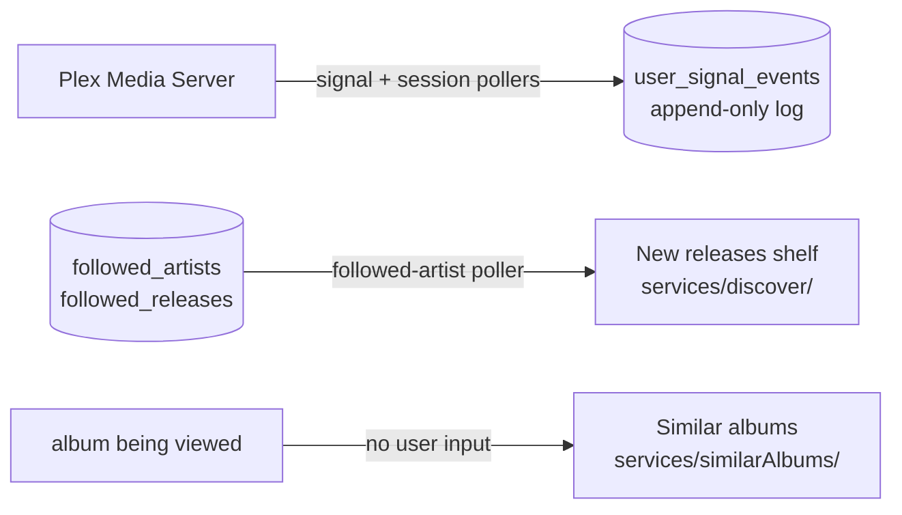

# Data flows

Mermaid diagrams for how listening data gets into Tunearr and how the remaining
music-discovery features turn data into something on screen. Every diagram is drawn from the
code it describes; the file and function names in the nodes are the real ones.

| Document                               | What it covers                                                 |
| -------------------------------------- | -------------------------------------------------------------- |
| [plex-ingestion.md](plex-ingestion.md) | Reading Plex into `user_signal_events`, and folding it back    |
| [new-releases.md](new-releases.md)     | The new-releases shelf and the followed-artist pipeline behind |
| [similar-albums.md](similar-albums.md) | Album-page similarity                                          |

## The shape of it

The listening log is captured and stored, but nothing on screen reads it. Similar albums
describes the album being viewed, not the viewer, which is what lets one cache entry serve
everyone.
