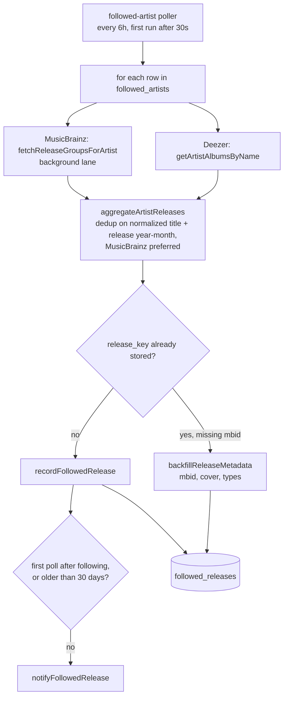
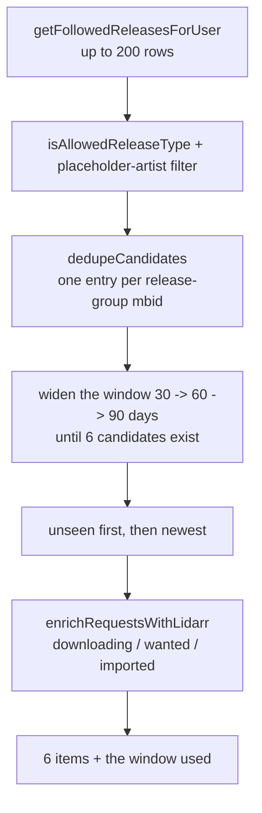

# New releases shelf

Six cards on Discover, all releases by artists the user follows. The followed-artist poller
records them; the shelf reads what it recorded.

Code: `server/services/discover/newReleases.ts`, `server/services/followed/`.

## The followed pipeline (persisted, poller-driven)

The first poll after following records the entire back catalogue, and none of it is news to
the person who just chose to follow that artist, so notifications are suppressed for it.

## The shelf (per request)

A release by two followed artists is stored once per artist, which is why the shelf dedupes on
the release-group mbid. The window widens rather than the count shrinking, because a
half-empty shelf reads as broken while a 90 day window reads as quiet.
