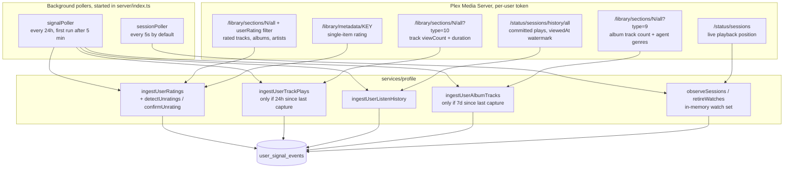
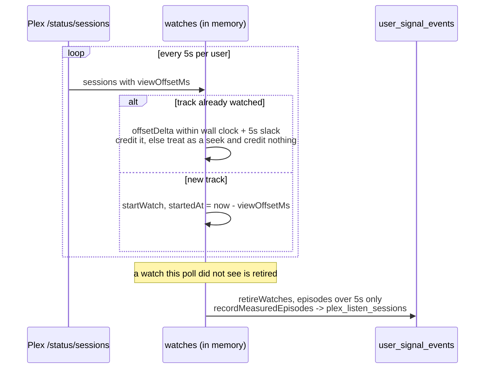
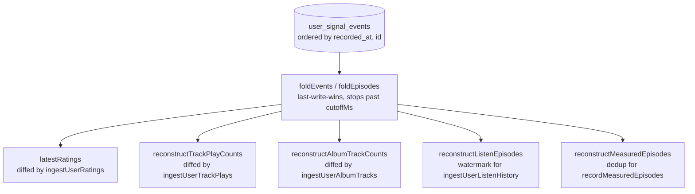

# Plex ingestion

Two pollers copy Plex into an append-only log (`user_signal_events`). The log is the durable
copy of signals Plex itself can lose (history purges, library re-imports) and the only place
trends could ever be measured from, since a cumulative counter cannot be diffed against its
own past. Nothing reads it for recommendations any more: it is kept as data.

Code: `server/api/plex/`, `server/services/profile/`, `server/db/signalEvents.ts`.

## What is read, and by which poller

Ordering inside one sweep matters: plays are captured before history, so an episode for a
track first seen this sweep already has its length stored when it joins onto it. Both
pollers are gated on `listeningCaptureEnabled` (the "Record listening history" switch on the
Plex integration page) and assume a single instance.

## Event kinds

Everything is a delta. Nothing is ever updated in place.

| Kind                   | Written by                | Payload                               | Semantics                                                        |
| ---------------------- | ------------------------- | ------------------------------------- | ---------------------------------------------------------------- |
| `plex_rating`          | `ingestUserRatings`       | one rated item                        | new, changed, key-backfilled, or a confirmed clear (`rating: 0`) |
| `plex_track_plays`     | `ingestUserTrackPlays`    | tracks whose count grew               | monotonic; also re-emitted to backfill `durationMs`              |
| `plex_album_tracks`    | `ingestUserAlbumTracks`   | albums whose count or genres changed  | not monotonic, any difference is recorded                        |
| `plex_listen_history`  | `ingestUserListenHistory` | episodes, keyed `ratingKey:viewedAt`  | one row per committed play, with `startedAt` back-derived        |
| `plex_listen_sessions` | `recordMeasuredEpisodes`  | episodes, keyed `ratingKey@startedAt` | observed listening, including plays that never committed         |

`plex_plays` was the artist-level series `plex_track_plays` replaced. It carried no
per-track detail, so nothing downstream could roll it up by album or measure how an artist's
listening spread across their tracks — it only ever entered as a per-artist total taken as
the higher of the two series. It stopped being written long before it stopped being read,
and is now neither. Rows may still exist in the table; nothing folds them.

Large captures are chunked at 2000 items per event. The fold is last-write-wins in written
order, so N ordered chunks reconstruct identically to one oversized event.

## Session watching

The history log records which plays happened; it cannot see a 90 minute set abandoned after
twelve minutes, because Plex commits a play at the halfway mark or not at all. The session
poller is the only source that can.

The position is the evidence, not `Player.state`, which has been observed reporting `paused`
while audio played. A failed read keeps the user's windows open rather than committing them
early. Watches are memory-only: a restart loses the windows in flight.

## Reading the log back

Each ingest diffs what Plex reports now against what the log already holds, so the log is
folded back into state on every sweep. The folds are last-write-wins in written order and
stop at an optional cutoff.

